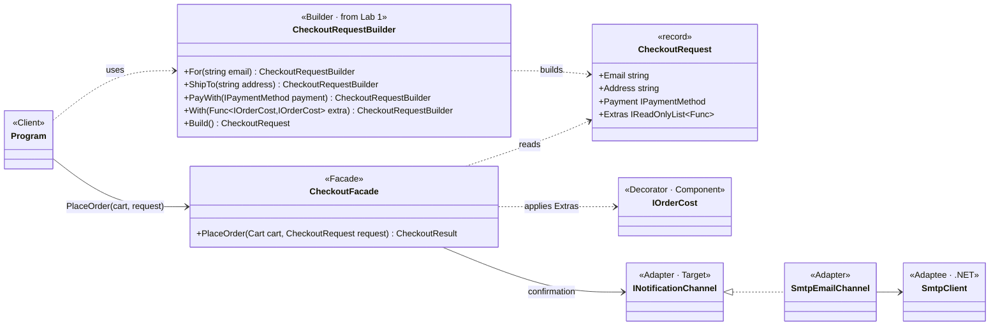
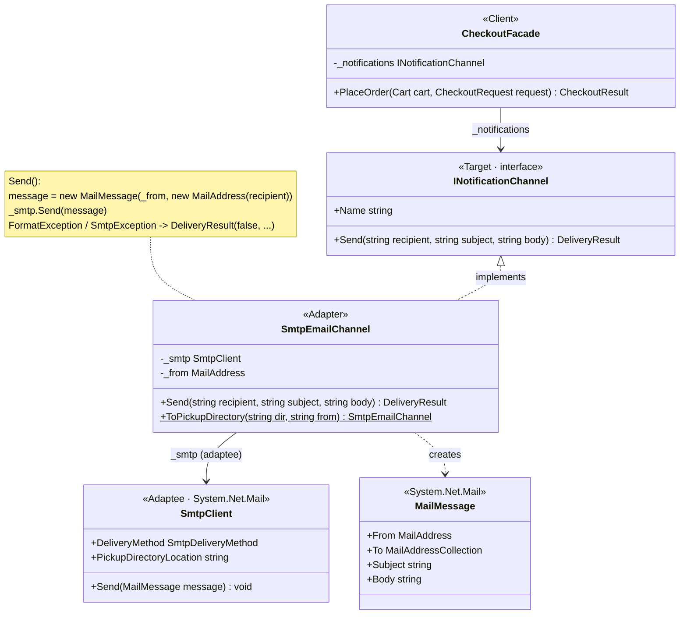
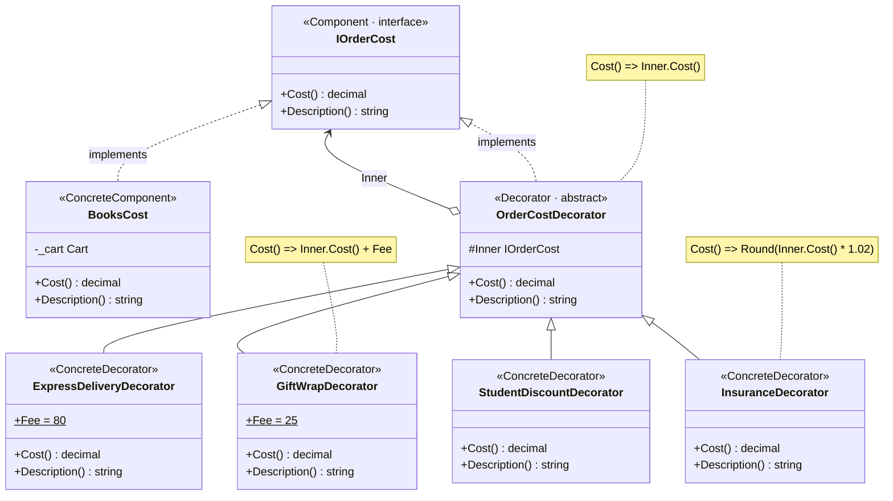
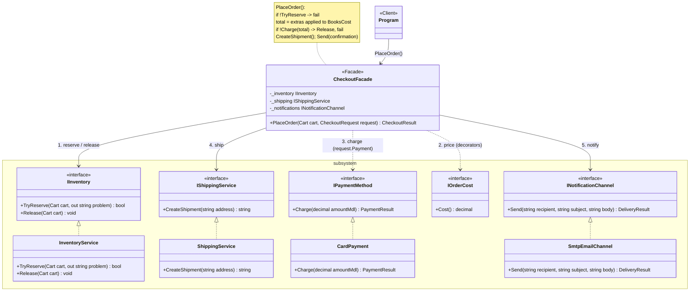

# Report on laboratory work no. 2

**Course:** Software Design Techniques and Mechanisms (TMPS)  
**Topic:** Structural Design Patterns  
**Done by:** st. gr. FAF-243, Buliga Vladislav  
**Checked by:** Istrati Daniel, asist. univ.  
Chișinău, 2026

---


## 1 AIM OF THE WORK


### 1.1 Purpose of the laboratory work

The purpose of this laboratory work is to understand the structural design patterns, which describe how classes and objects are put together into bigger structures, and to apply three of them in a real project. The goal is not only to write the classes of each pattern, but to place every pattern where it solves an actual problem of the application, to make the patterns work together, and to keep the client code dependent on interfaces, so that new variants can be added later only by writing new classes.


### 1.2 Problem statement

**Tasks of the laboratory work:**

- implement at least 3 structural design patterns in one project, each with its full structure;
- make the patterns interact: at least one execution path must go through two or more of them;
- make the client code depend on abstractions and keep the design open for extension;
- build on Lab 1 by reusing a creational pattern to create the objects the structural patterns work with;
- adapt a class that I did not write (a library or an API);
- write at least 2 unit tests per pattern that prove its key property;
- study the other structural patterns that were not implemented.

The project continues the online bookstore from the previous laboratory works and implements its checkout in C# on .NET 8. The implemented patterns are Adapter (the e-mail confirmation sent through the .NET library class System.Net.Mail.SmtpClient), Decorator (the optional extras added to the price of an order) and Facade (one call that runs the whole checkout). The checkout request is created with a Builder, the creational pattern reused from Lab 1.


## 2 THEORETICAL BACKGROUND


### 2.1 Structural Design Patterns

Structural patterns are the second group of the Gang of Four catalogue. They deal with the way classes and objects are composed into larger structures. They are divided into structural class patterns, which use inheritance, and structural object patterns, which use composition: one object holds a reference to another and delegates work to it. Composition can be changed at run time and does not lead to large rigid class hierarchies, which is why most of these patterns are object patterns. Several of them look alike in code, because they are all "an object that wraps another object", so the real difference between them is their intent.

*Table 2.1 – The structural design patterns*

| Pattern | Intent in one line |
|---|---|
| Adapter | Make an existing class with an incompatible interface work with our code |
| Bridge | Separate an abstraction from its implementation so both can vary independently |
| Composite | Treat single objects and groups of objects in the same way, as a tree |
| Decorator | Add responsibilities to an object at run time by wrapping it, in any combination |
| Facade | Give one simple interface to a complex subsystem |
| Flyweight | Share the common state of many small objects to save memory |
| Proxy | Control access to an object through a stand-in with the same interface |


### 2.2 Adapter

Adapter converts the interface of an existing class into the interface the client expects. The roles are the Client, the Target (the interface the client uses), the Adaptee (the existing class with the wrong interface) and the Adapter, which implements the Target and translates every call to the Adaptee. In the object version of the pattern the adapter holds a reference to the adaptee; in the class version it inherits from it. The adapter makes sense only when the incompatibility is real, so the adaptee should be code that we did not design and cannot change.


### 2.3 Decorator

Decorator adds responsibilities to an object dynamically. Its roles are the Component (the common interface), the Concrete Component (the plain object), the base Decorator, which implements the Component and holds a reference to another Component, and the Concrete Decorators, which add their behaviour before or after forwarding the call. Because a decorator has the same interface as the object it wraps, decorators can be stacked in any number and any order, and the client cannot tell a decorated object from a plain one. It replaces a subclass for every combination of features.


### 2.4 Facade

Facade provides one unified, simple interface to a group of classes, the subsystem. The facade does not do the work itself: it knows which subsystem objects to call and in which order, and it delegates to them. The subsystem classes are not hidden and can still be used directly. A facade that starts to contain business logic turns into a "god class", which is the main thing to avoid.


### 2.5 The Other Structural Patterns

Bridge splits a hierarchy that grows in two independent directions into two hierarchies, an abstraction and an implementation, connected by a reference (the bridge); for example notification types and delivery channels, so that N types and M channels need N + M classes instead of N × M. Composite builds tree structures in which a leaf and a group implement the same interface, like a single book and a box set of books that both have a price, so the client never checks types. Flyweight shares the intrinsic (common, immutable) state of many fine-grained objects through a factory with a cache, while the extrinsic state is passed in from outside. Proxy is a stand-in with exactly the same interface as the real object that controls access to it: it can check permissions, load the real object lazily, cache results or call a remote server.


## 3 IMPLEMENTATION


### 3.1 Domain Description

The application is the checkout of a small online bookstore. A customer has a cart with books and chooses how to receive and pay for the order: the delivery address, the payment card and optional extras such as gift wrapping, express delivery, insurance or a student discount. Placing the order reserves the books in stock, calculates the price with the chosen extras, charges the card, creates a parcel with a tracking number and sends a confirmation e-mail. If the books are sold out no money is taken, and if the card is declined the reservation is cancelled, so the stock always stays correct.


### 3.2 Project Structure

The solution has three projects: a class library with the domain and the patterns, a console application that is the only client of the system, and a test project. The folders are named after their responsibility in the bookstore, not after the patterns.

*Listing 3.1 – Structure of the solution*

```
lab2/
├── Bookstore.sln
├── src/Bookstore.Core/        class library
│   ├── Domain/                cart, request, payment
│   ├── Creation/              Builder (from Lab 1)
│   ├── Pricing/               Decorator
│   ├── Notifications/         Adapter
│   └── Checkout/              Facade + subsystem
├── src/Bookstore.App/         the client (Program.cs)
├── tests/Bookstore.Tests/     xUnit tests + Fakes/
└── docs/diagrams/             class diagrams
```

The demo is started and the tests are run from the lab2 folder:

*Listing 3.2 – Running the demo and the tests*

```bash
dotnet run --project src/Bookstore.App
dotnet test
```


### 3.3 How the Patterns Interact

The patterns are not three separate demos: they are connected inside one call. The client builds a CheckoutRequest with the CheckoutRequestBuilder from Lab 1 and calls CheckoutFacade.PlaceOrder(). The facade wraps the price of the books in the decorators chosen in the request, charges the payment method and, at the end, sends the confirmation through INotificationChannel, behind which the SmtpEmailChannel adapter calls the .NET SmtpClient. The path is: client → Builder → Facade → Decorator chain → payment → shipping → Adapter → SmtpClient. Every link of this path is an interface (IOrderCost, IPaymentMethod, IInventory, IShippingService, INotificationChannel), so the facade never names the concrete class behind it.

*Figure 3.1 – How the patterns are connected in one checkout*



Rendered image: [docs/diagrams/interaction.png](docs/diagrams/interaction.png)

The extras are passed as functions that wrap the price, for example c => new GiftWrapDecorator(c). Because of this, a new extra, such as a Black Friday discount, needs only one new decorator class: neither the builder nor the facade has to be changed. The same is true for a new payment method (a new IPaymentMethod) or a new notification channel (a new INotificationChannel).


### 3.4 Adapter – E-mail Confirmation through System.Net.Mail.SmtpClient

**Problem**

After an order is placed, the customer must get a confirmation e-mail. .NET already has a class for sending e-mail, System.Net.Mail.SmtpClient, but it is a library class that I did not design and cannot change, and its interface does not fit the bookstore: it does not take a recipient and a text, it wants a MailMessage object built from MailAddress objects, and it reports problems by throwing exceptions (FormatException for a bad address, SmtpException for a server error). The checkout should not know any of this; it only wants to say "send this text to this person" and get back whether it worked.

**Solution**

The bookstore defines its own Target interface, INotificationChannel, with one method Send(recipient, subject, body) that returns a DeliveryResult. The SmtpEmailChannel adapter implements it and holds the SmtpClient (the Adaptee) in a field. Send() builds the MailMessage, calls SmtpClient.Send() and turns the exceptions into a DeliveryResult. The facade, which is the Client, only has a reference to INotificationChannel. Since no real mail server is available, the SmtpClient is configured with its own pickup-directory mode, in which the library writes every e-mail as an .eml file into a folder; the adapter does not change at all if a real server is configured instead.

*Figure 3.2 – Class diagram of the Adapter*



Rendered image: [docs/diagrams/adapter.png](docs/diagrams/adapter.png)

*Listing 3.3 – SmtpEmailChannel.Send(), the translation done by the adapter* (source: [SmtpEmailChannel.cs](src/Bookstore.Core/Notifications/SmtpEmailChannel.cs#L38-L59))

```csharp
public DeliveryResult Send(string recipient, string subject, string body)
{
    try
    {
        using var message = new MailMessage(_from, new MailAddress(recipient))
        {
            Subject = subject,
            Body = body,
            BodyEncoding = Encoding.UTF8
        };
        _smtp.Send(message);
        return new DeliveryResult(true, $"e-mail to {recipient} handed to SMTP");
    }
    catch (FormatException)
    {
        return new DeliveryResult(false, $"\"{recipient}\" is not a valid e-mail address");
    }
    catch (SmtpException e)
    {
        return new DeliveryResult(false, "SMTP error: " + e.Message);
    }
}
```

The adapter does three translations: our strings become MailAddress and MailMessage objects, our call becomes SmtpClient.Send(MailMessage), and the library's exceptions become a DeliveryResult. The checkout never sees any System.Net.Mail type.

**Unit tests**

*Table 3.1 – Unit tests of the Adapter (SmtpEmailChannelTests)*

| Test | What it proves |
|---|---|
| Send_TranslatesTheCallIntoAnEmailWrittenBySmtpClient | A call through INotificationChannel reaches SmtpClient: exactly one .eml file is written, with the right To, Subject and From |
| Send_InvalidAddress_ReturnsFailureInsteadOfThrowing | The FormatException of the library is translated into DeliveryResult(false, ...) and no e-mail is written |


### 3.5 Decorator – Extras on the Order Price

**Problem**

A customer can add any combination of extras to an order: gift wrapping (+25 MDL), express delivery (+80 MDL), insurance (+2% of the value) and a student discount (−10%). With inheritance every combination would need its own subclass (GiftWrapExpressInsuredOrder and so on), which is 16 classes for 4 extras, and every new extra would double that number.

**Solution**

IOrderCost is the Component, with Cost() and Description(). BooksCost is the Concrete Component and returns the subtotal of the cart. The abstract OrderCostDecorator implements IOrderCost, keeps the wrapped object in the field Inner and by default forwards the calls to it. The four Concrete Decorators override Cost() and Description(): they first ask Inner for its value and then add their own extra. Because every decorator is itself an IOrderCost, decorators can wrap other decorators in any number and order.

*Figure 3.3 – Class diagram of the Decorator*



Rendered image: [docs/diagrams/decorator.png](docs/diagrams/decorator.png)

*Listing 3.4 – The base decorator and one concrete decorator* (source: [OrderCost.cs](src/Bookstore.Core/Pricing/OrderCost.cs#L26-L34), [Extras.cs](src/Bookstore.Core/Pricing/Extras.cs#L6-L14))

```csharp
public abstract class OrderCostDecorator : IOrderCost
{
    protected readonly IOrderCost Inner;

    protected OrderCostDecorator(IOrderCost inner) => Inner = inner;

    public virtual decimal Cost() => Inner.Cost();
    public virtual string Description() => Inner.Description();
}

public class GiftWrapDecorator : OrderCostDecorator
{
    public const decimal Fee = 25m;

    public GiftWrapDecorator(IOrderCost inner) : base(inner) { }

    public override decimal Cost() => Inner.Cost() + Fee;
    public override string Description() => Inner.Description() + " + gift wrap (25)";
}
```

The whole pattern is in Inner.Cost() + Fee: the decorator calls the object it wraps and adds its behaviour to the result, while keeping the same interface. A new extra is one new subclass of OrderCostDecorator; nothing else changes.

**Unit tests**

*Table 3.2 – Unit tests of the Decorator (OrderCostDecoratorTests)*

| Test | What it proves |
|---|---|
| FixedFeeDecorators_StackedInAnyOrder_GiveTheSameTotal | Gift wrap and express delivery stacked in both orders give 855.00 MDL |
| FullStack_GivesTheExpectedTotalAndDescription | Four decorators on one object, used through IOrderCost, give 784.89 MDL and the full description |
| PercentageDecorator_ResultDependsOnItsPositionInTheStack (2 cases) | A percentage decorator applied before or after a fixed fee gives 755.00 or 747.00 MDL, as calculated by hand |


### 3.6 Facade – CheckoutFacade

**Problem**

Placing an order needs five steps done in the right order by different objects: reserve the books (inventory), calculate the price (the decorator chain), charge the card (payment), create the parcel (shipping) and send the confirmation (notification channel). There are also two error cases with different handling: sold-out books must stop the order before any money is taken, and a declined card must give the reserved books back. If every client did this itself, the order of the steps and the rollback would be repeated and could easily be forgotten.

**Solution**

CheckoutFacade offers one method, PlaceOrder(cart, request). It receives its subsystem through the constructor as interfaces (IInventory, IShippingService, INotificationChannel); the payment method comes with the request as an IPaymentMethod. The facade has no business rules of its own: the prices are in the decorators, the stock rules in the inventory, the payment rules in the payment method. It only calls these objects in order and handles the two failure paths, so it does not turn into a god class.

*Figure 3.4 – Class diagram of the Facade and its subsystem*



Rendered image: [docs/diagrams/facade.png](docs/diagrams/facade.png)

*Listing 3.5 – CheckoutFacade.PlaceOrder()* (source: [CheckoutFacade.cs](src/Bookstore.Core/Checkout/CheckoutFacade.cs#L25-L56))

```csharp
public CheckoutResult PlaceOrder(Cart cart, CheckoutRequest request)
{
    // 1. stock
    if (!_inventory.TryReserve(cart, out string problem))
        return new CheckoutResult(false, 0m, "out of stock: " + problem);

    // 2. price: wrap the books in the chosen decorators, in order
    IOrderCost cost = new BooksCost(cart);
    foreach (var extra in request.Extras)
        cost = extra(cost);
    decimal total = cost.Cost();
    Console.WriteLine($"    [Price] {cost.Description()} = {total:0.00} MDL");

    // 3. payment; on failure give the books back
    PaymentResult paid = request.Payment.Charge(total);
    if (!paid.Success)
    {
        _inventory.Release(cart);
        return new CheckoutResult(false, total, $"payment failed ({request.Payment.Name}): {paid.Message}");
    }

    // 4. shipping and 5. confirmation
    string tracking = _shipping.CreateShipment(request.Address);
    // ... send the confirmation through _notifications and return the result
```

PlaceOrder() only delegates: each line is a call to one subsystem object through an interface, and the facade decides only the order of the calls and what happens when a step fails.

**Unit tests**

The subsystem is replaced by hand-written fakes (tests/Bookstore.Tests/Fakes) that all write into one shared CallLog, so the tests can check the exact order of the calls.

*Table 3.3 – Unit tests of the Facade (CheckoutFacadeTests)*

| Test | What it proves |
|---|---|
| PlaceOrder_CallsTheSubsystemInTheRightOrder | The calls are reserve → charge → ship → notify, the payment receives the price from the decorator (375.00 MDL) and the confirmation goes to the customer |
| PlaceOrder_PaymentDeclined_ReleasesTheStockAndDoesNotShip | When the payment fails the calls are reserve → charge → release, with no shipping and no e-mail |
| PlaceOrder_OutOfStock_StopsBeforeTakingMoney | When the books are sold out only reserve is called, the payment is never charged |


### 3.7 Reused from Lab 1 – CheckoutRequestBuilder

The objects the structural patterns work with are created with the Builder pattern from Lab 1. CheckoutRequestBuilder collects the e-mail, the address, the payment method and the extras step by step with chained calls, and Build() checks that nothing required is missing before it creates the CheckoutRequest. The extras are stored as functions that wrap an IOrderCost, so the builder does not know any concrete decorator.

*Listing 3.6 – CheckoutRequestBuilder.Build()* (source: [CheckoutRequestBuilder.cs](src/Bookstore.Core/Creation/CheckoutRequestBuilder.cs#L41-L51))

```csharp
public CheckoutRequest Build()
{
    if (string.IsNullOrWhiteSpace(_email))
        throw new InvalidOperationException("A checkout needs the customer's e-mail");
    if (string.IsNullOrWhiteSpace(_address))
        throw new InvalidOperationException("A checkout needs a delivery address");
    if (_payment is null)
        throw new InvalidOperationException("A checkout needs a payment method");

    return new CheckoutRequest(_email, _address, _payment, _extras.ToList());
}
```

*Table 3.4 – Unit tests of the Builder (CheckoutRequestBuilderTests)*

| Test | What it proves |
|---|---|
| Build_KeepsTheExtrasInTheOrderTheyWereAdded | Two extras are kept in order and give (350 + 25) × 0.9 = 337.50 MDL |
| Build_WithoutPaymentMethod_Throws | Build() refuses an incomplete request |


### 3.8 The Demo Program

Program.cs is the only client of the system. It shows the adapter sending a real e-mail through SmtpClient and refusing an invalid address, the decorators stacked in different ways, and four complete orders through the facade: a gift order with a student discount, an express order with insurance, a sold-out book and a declined card.

*Listing 3.7 – Output of dotnet run*

```text

================================================================
1. ADAPTER - System.Net.Mail.SmtpClient behind INotificationChannel
================================================================
  Send("ana@mail.md", ...)   -> Delivered=True: e-mail to ana@mail.md handed to SMTP
  SmtpClient wrote one .eml file into outbox/ with the headers:
    From: "Libraria FAF" <orders@librariafaf.md>
    To: ana@mail.md
    Subject: Welcome to Libraria FAF
  Send("not-an-email", ...)  -> Delivered=False: "not-an-email" is not a valid e-mail address

================================================================
2. DECORATOR - extras wrapped around the price
================================================================
   750.00 MDL  <- 2 book(s)
   775.00 MDL  <- 2 book(s) + gift wrap (25)
   784.89 MDL  <- 2 book(s) + gift wrap (25) + express delivery (80) + insurance (2%) - student discount (10%)

  The order of the wrappers matters for percentages:
   755.00 MDL  <- 2 book(s) - student discount (10%) + express delivery (80)
   747.00 MDL  <- 2 book(s) + express delivery (80) - student discount (10%)

================================================================
3. FACADE - the whole checkout in one call
================================================================
  path: client -> CheckoutFacade -> Decorator chain -> payment -> shipping
        -> INotificationChannel (SmtpEmailChannel adapter) -> SmtpClient

a) gift order with student discount
    [Inventory] reserved 2 x Clean Code
    [Price] 2 book(s) + gift wrap (25) - student discount (10%) = 652.50 MDL
    [Payment] 652.50 MDL charged to card *1234 (PAY-7001)
    [Shipping] parcel to str. Studenților 9/7, Chișinău, tracking MD501
    [e-mail (SMTP)] e-mail to ana@mail.md handed to SMTP
  => SUCCESS: ref PAY-7001, tracking MD501, confirmation sent

b) express order with insurance
    [Inventory] reserved 1 x Design Patterns
    [Price] 1 book(s) + express delivery (80) + insurance (2%) = 489.60 MDL
    [Payment] 489.60 MDL charged to card *4444 (PAY-7002)
    [Shipping] parcel to bd. Dacia 41, Chișinău, tracking MD502
    [e-mail (SMTP)] e-mail to ion@mail.md handed to SMTP
  => SUCCESS: ref PAY-7002, tracking MD502, confirmation sent

c) a book that is sold out
  => FAILED: out of stock: "Effective Java" has only 0 in stock

d) declined card: the reservation is rolled back
    [Inventory] reserved 1 x Design Patterns
    [Price] 1 book(s) = 400.00 MDL
    [Payment] card *0002 declined
    [Inventory] reservation cancelled, books returned to stock
  => FAILED: payment failed (card *0002): card declined

Stock left: Clean Code 3, Design Patterns 1, Effective Java 0
E-mails in the outbox: 3
```

The numbers can be checked by hand. Order a) costs (2 × 350 + 25) × 0.9 = 652.50 MDL and order b) (400 + 80) × 1.02 = 489.60 MDL. Order c) stops at the stock check and order d) is rolled back, so the stock ends at Clean Code 5 − 2 = 3 and Design Patterns 2 − 1 = 1. Three e-mails were written by SmtpClient: the welcome message and the confirmations of orders a) and b).


### 3.9 Running the Tests

All 11 tests run with one command, dotnet test, from the lab2 folder: 2 for the Adapter, 4 for the Decorator (one of them a theory with 2 cases), 3 for the Facade and 2 for the Builder.


## 4 RESULTS

*Table 4.1 – The implemented structural patterns*

| Pattern | Role classes | Problem solved in the bookstore | Open for extension by |
|---|---|---|---|
| Adapter | INotificationChannel (Target), SmtpEmailChannel (Adapter), SmtpClient (Adaptee), CheckoutFacade (Client) | Sending e-mail through a .NET library class whose interface does not fit the checkout | A new channel (SMS, push) = a new INotificationChannel class |
| Decorator | IOrderCost, BooksCost, OrderCostDecorator, 4 concrete decorators | Any combination of optional extras without a subclass per combination | A new extra = a new OrderCostDecorator subclass |
| Facade | CheckoutFacade + IInventory, IShippingService, IPaymentMethod, INotificationChannel | A five-step checkout with rollback, done in one call | New subsystem implementations are injected through the constructor |


## CONCLUSION

In this laboratory work I implemented three structural patterns, Adapter, Decorator and Facade, in the checkout of the online bookstore, and connected them in one execution path: the client builds a request with the Builder from Lab 1, the facade prices it with the decorator chain and confirms it through the adapter over System.Net.Mail.SmtpClient. Every link of this path is an interface, so the facade never knows which concrete extras, payment method or notification channel it is using, and new variants are added only by writing new classes. The 11 unit tests prove the key property of each pattern: the adapter really translates calls and errors to the library, the decorators can be stacked and give the expected totals, and the facade calls its subsystem in the right order and rolls back correctly.

The part that was harder than expected was the Adapter. In my first version the two "external" payment services were classes I had written myself, so there was no real incompatibility and the pattern was only a name. Adapting a real library class forced me to deal with its actual interface: building MailMessage and MailAddress objects, catching its exceptions, and finding a way to test it without a mail server, which I solved with the library's pickup-directory mode. Another surprise was the Decorator: stacking works in any order, but the order changes the result as soon as percentages are mixed with fixed fees (755.00 against 747.00 MDL), so the order of the extras has to be decided by the business rules and kept by the builder.

If I designed it again, I would make the extras proper classes (for example an IOrderExtra interface) instead of functions, so they could be listed, named and saved with the order, and I would move the console messages out of the subsystem classes into a separate logger, so the domain classes would not depend on the console. I would also consider a Proxy in front of the payment method to check limits or permissions, and a Composite for box sets of books, which fit the same project naturally.


## REFERENCES

1. Gamma, E., Helm, R., Johnson, R., Vlissides, J. Design Patterns: Elements of Reusable Object-Oriented Software. Addison-Wesley, 1994. Chapter 4 "Structural Patterns".

2. Drumea, V. Software Design Techniques and Mechanisms – Structural Design Patterns (course slides). UTM, Chișinău.

3. SourceMaking. Structural patterns. Available at: https://sourcemaking.com/design_patterns/structural_patterns

4. Microsoft. SmtpClient Class (System.Net.Mail) – .NET API documentation. Available at: https://learn.microsoft.com/dotnet/api/system.net.mail.smtpclient

5. xUnit.net documentation. Available at: https://xunit.net/

